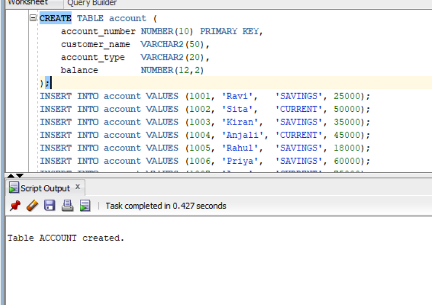
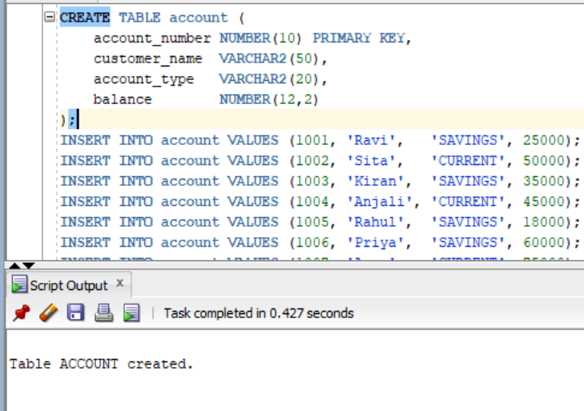
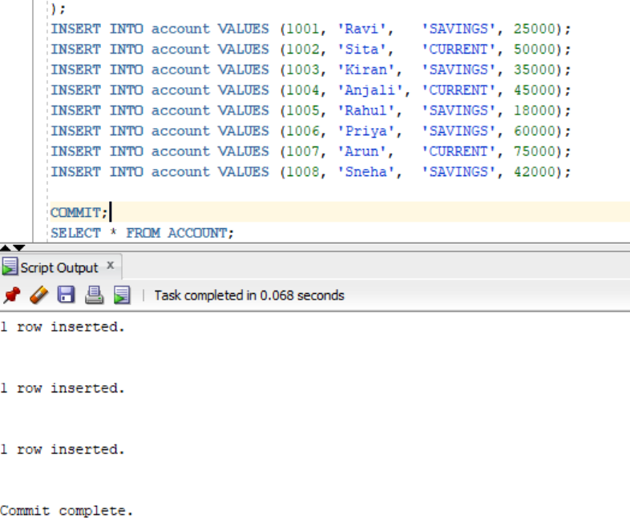
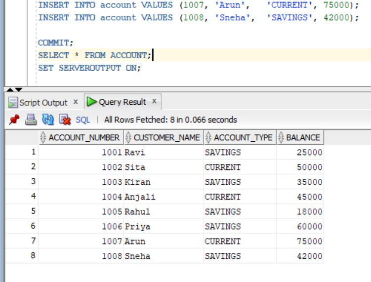
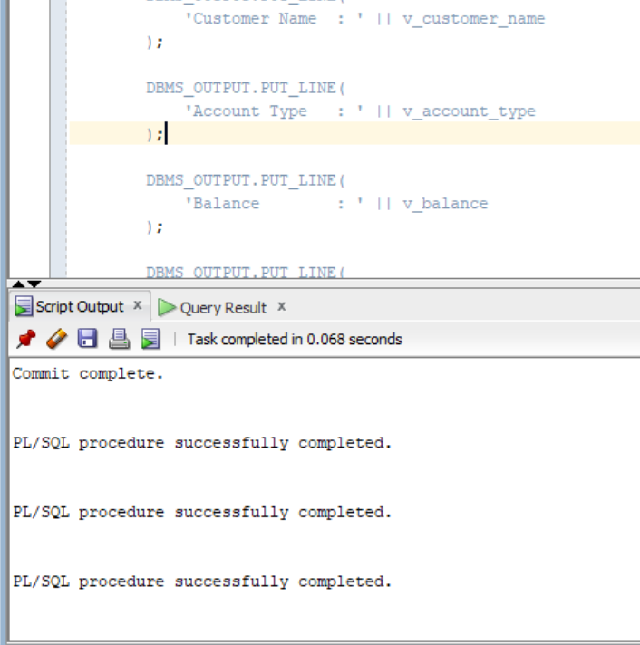

##```
CREATE TABLE account (
    account_number NUMBER(10) PRIMARY KEY,
    customer_name  VARCHAR2(50),
    account_type   VARCHAR2(20),
    balance        NUMBER(12,2)
);
```

```
INSERT INTO account VALUES (1001, 'Ravi',   'SAVINGS', 25000);
INSERT INTO account VALUES (1002, 'Sita',   'CURRENT', 50000);
INSERT INTO account VALUES (1003, 'Kiran',  'SAVINGS', 35000);
INSERT INTO account VALUES (1004, 'Anjali', 'CURRENT', 45000);
INSERT INTO account VALUES (1005, 'Rahul',  'SAVINGS', 18000);
INSERT INTO account VALUES (1006, 'Priya',  'SAVINGS', 60000);
INSERT INTO account VALUES (1007, 'Arun',   'CURRENT', 75000);
INSERT INTO account VALUES (1008, 'Sneha',  'SAVINGS', 42000);

COMMIT;
```

```
SELECT * FROM ACCOUNT;
```

```
SET SERVEROUTPUT ON;

DECLARE

    -- Parameterized cursor
    CURSOR C_ACCOUNT (p_account_type VARCHAR2) IS
        SELECT account_number,
               customer_name,
               account_type,
               balance
        FROM account
        WHERE account_type = p_account_type;

    -- Variables to store fetched values
    v_account_number account.account_number%TYPE;
    v_customer_name  account.customer_name%TYPE;
    v_account_type   account.account_type%TYPE;
    v_balance        account.balance%TYPE;

BEGIN

    -- Open cursor by passing account type
    OPEN C_ACCOUNT('SAVINGS');

    -- Fetch records one by one
    LOOP

        FETCH C_ACCOUNT
        INTO v_account_number,
             v_customer_name,
             v_account_type,
             v_balance;

        -- Exit when all records are processed
        EXIT WHEN C_ACCOUNT%NOTFOUND;

        -- Display account details
        DBMS_OUTPUT.PUT_LINE(
            'Account Number : ' || v_account_number
        );

        DBMS_OUTPUT.PUT_LINE(
            'Customer Name  : ' || v_customer_name
        );

        DBMS_OUTPUT.PUT_LINE(
            'Account Type   : ' || v_account_type
        );

        DBMS_OUTPUT.PUT_LINE(
            'Balance        : ' || v_balance
        );

        DBMS_OUTPUT.PUT_LINE(
            '-----------------------------'
        );

    END LOOP;

    -- Close the cursor
    CLOSE C_ACCOUNT;

END;
/
```



