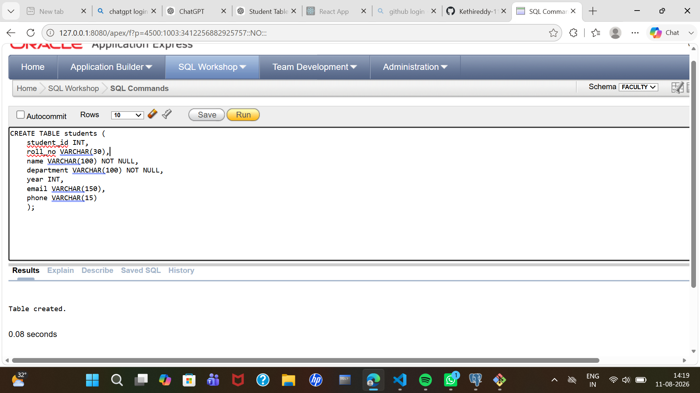

# This is my sql program
```
CREATE TABLE students (
    student_id INT,
    roll_no VARCHAR(30),
    name VARCHAR(100) NOT NULL,
    department VARCHAR(100) NOT NULL,
    year INT,
    email VARCHAR(150),
    phone VARCHAR(15)
    );
```

